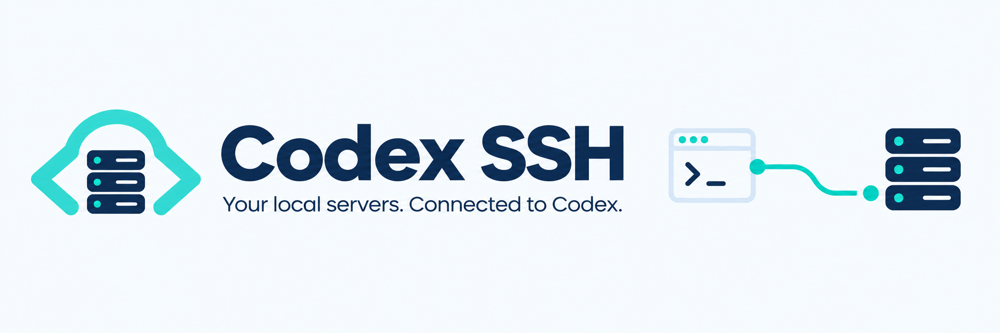
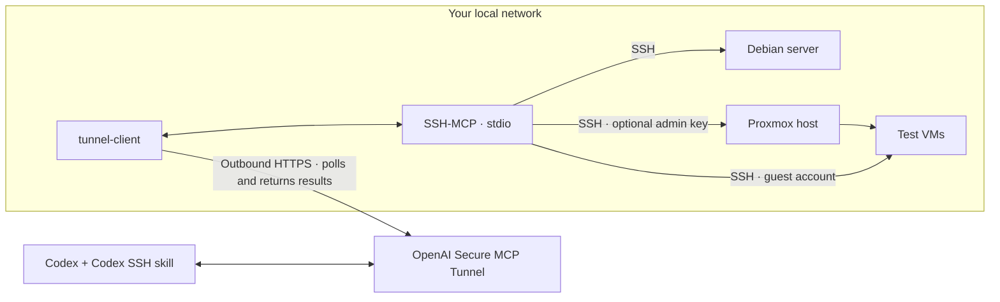

<p align="center">
  
</p>

# Codex SSH

**Manage your local Debian server or Proxmox host with Codex over SSH, connected through a Secure MCP Tunnel.**

The Codex SSH skill gives Codex a practical workflow for checking your server,
provisioning test VMs and running tests. The tools come from
[slepp/ssh-mcp](https://github.com/slepp/ssh-mcp); OpenAI's
[tunnel-client](https://github.com/openai/tunnel-client) connects them to supported
OpenAI products without a public MCP listener.

[Get started](#install-on-your-local-host) · [Setup guide](docs/onboarding.md) ·
[Download skill ZIP](https://raw.githubusercontent.com/geco91/codex-ssh-skill/v0.2.0/downloads/v0.2.0/codex-ssh.zip) ·
[SHA-256](downloads/v0.2.0/SHA256SUMS) · [Releases](https://github.com/geco91/codex-ssh-skill/releases)

Main contains the prepared **v0.2.1 installer fixes**, not a published release.
The stable download/install links below remain on v0.2.0. The candidate's
`scripts/install.sh` requires the future v0.2.1 tag; for authorized testing from
this checkout use `bash scripts/setup.sh`. Persistent autostart remains separate
in PR #4. See [recovery and release status](docs/bootstrap.md#dependency-source-errors-and-phase-by-phase-recovery).

## How it fits together



Run the client and MCP server on your local host. Choose a plain Debian server,
or use Proxmox to manage the host and test inside its guests. The **skill provides
instructions**; the **MCP connection provides tools**. You install both.

## Install on your local host

You need Debian 12/13 or a supported Debian-based Proxmox host, systemd,
amd64/arm64, root access, `curl` and CA certificates. Run this **on that local host**:

```bash
curl --proto '=https' --tlsv1.2 -fsSL https://raw.githubusercontent.com/geco91/codex-ssh-skill/v0.2.0/scripts/install.sh | sudo bash
```

Already root, as on many Proxmox consoles? Replace `sudo bash` with `bash`.
If curl is missing, install it first: `apt-get update && apt-get install -y curl ca-certificates`.
Prefer to inspect before running? Download the same `install.sh`, read it, then run
it locally. The launcher verifies a pinned installer-bundle SHA-256 before execution.

The guide will:

1. Detect Debian or Proxmox and install/check the pinned SSH-MCP and tunnel client.
2. On Proxmox, offer optional VM administration. This grants **full host-root
   access** through a separate local SSH key; leave it off for an unprivileged setup.
3. Ask for your **tunnel ID** and **runtime API key** using a hidden key prompt.
4. Start the tunnel using the client's native runtime manager and check its status.
5. Print the remaining product-connection and skill-installation steps.

You can skip the tunnel prompt and configure it later. An existing setup is
preserved; the guide does not rotate keys or take over unrelated runtimes.
Details and reserved paths: [local installer](docs/bootstrap.md).

### Get your tunnel ID and runtime key

Before the key prompt, open these pages in the intended OpenAI organization:

1. [Platform → Tunnels](https://platform.openai.com/settings/organization/tunnels):
   create/reuse a tunnel and copy its ID. Include the ChatGPT workspace and
   Platform organization that will use it. Creating/editing needs **Read + Manage**.
2. [Platform → Runtime API keys](https://platform.openai.com/settings/organization/api-keys):
   create a **Restricted** key with Tunnels **Read + Use**. Enter it only in the
   local hidden prompt; the installer stores a protected file reference.

Availability depends on your account, product and workspace permissions. In
Business, Enterprise or Edu workspaces, an admin may need to enable access. Check
that Tunnels and custom MCP connections are available for your account first;
the official guide also covers personal-account organization associations. See the
[official Secure MCP Tunnel guide](https://developers.openai.com/api/docs/guides/secure-mcp-tunnels)
and our [guided onboarding](docs/onboarding.md). Do not use an admin API key for
the long-lived runtime.

### Connect the MCP tools and add the skill

1. Keep the local client running. In the supported OpenAI product, add a custom
   MCP server with **Tunnel** as the connection and select your tunnel. The current
   documented ChatGPT entry point is [Plugins](https://chatgpt.com/plugins).
   Follow the [official connection steps](https://developers.openai.com/api/docs/guides/secure-mcp-tunnels#connect-from-chatgpt)
   and verify the tools in the actual Codex surface you intend to use.
2. Download the [skill ZIP](https://raw.githubusercontent.com/geco91/codex-ssh-skill/v0.2.0/downloads/v0.2.0/codex-ssh.zip)
   and its [checksum](downloads/v0.2.0/SHA256SUMS). Import it where skill ZIP import
   is supported. For Codex CLI/IDE, extract the `codex-ssh` folder into your
   project's `.agents/skills/`. [Skill installation details](docs/onboarding.md#4-install-the-skill).
3. Enable the connection and skill, then give Codex a task:

   > Use $codex-ssh with my selected local-server MCP connection. Read the setup
   > records, verify the assigned host identity, and report its status without
   > making changes.

The server provides its MCP tool schemas automatically; there is no extra API
schema to paste. Skill import does not create the connection. Local runtime
readiness does not prove product discovery: finish that first harmless call.

## Use it with Debian or Proxmox

| Setup | What Codex can do | Existing SSH alias |
| --- | --- | --- |
| Debian | Inspect and work inside the assigned account/checkout | `codex-test-local` |
| Proxmox, admin enabled | Inspect resources and provision authorized test guests | `codex-proxmox-host` |
| Guest VM | Install project dependencies and run guest tests | Assigned guest alias |

These aliases apply to this documented bootstrap installation. MCP runs as
`codex-test`; the optional admin alias authenticates as root using an existing
separate key. Keys stay on the MCP host. No ordinary root password is required.

For a VM task, provide the resource limit and intended network. Codex inspects
existing storage/bridges/images before provisioning and verifies guest login,
finished provisioning and the expected HTTP content. Generated **test guest**
credentials are recorded in that VM's Proxmox Description as the explicit operating
convention; host-root and tunnel credentials are excluded.

## Trust, versions and evidence

- The bootstrap pins its locally generated SSH host key. For another first-contact
  target, the skill supports explicitly authorized **TOFU** with `accept-new`,
  persistent known_hosts and strict checking afterward. Changed keys require
  investigation. [Access and trust](.agents/skills/codex-ssh/references/access.md).
- SSH-MCP is fixed to commit `37381ddc68a941b62ed8557dcbb5644dc3b6c5fd`
  (package 0.2.0), with a checked archive SHA-256. The tunnel client is fixed to
  0.0.16 with separate amd64/arm64 hashes. Downloads fail closed on a mismatch.
  There is no background auto-update. [Dependency lock and verification](docs/dependencies.md).
- A weekly GitHub Actions job checks those exact upstream bytes. Failure alerts
  follow your GitHub Actions notification settings; a mismatch is not permission
  to adopt the new bytes automatically.
- One real product-MCP → Proxmox → Debian guest → Hello World HTTP smoke test
  passed, including key and password logins. Wider platform coverage, reboot
  recovery and a separate Codex Cloud task are not established by that single run.
  [Validation](docs/validation.md) · [Live record](docs/live-testproxmox.md).

## Documentation and credits

[Onboarding](docs/onboarding.md) · [Installer and recovery](docs/bootstrap.md) ·
[Dependency integrity](docs/dependencies.md) · [Research](docs/research.md) ·
[Changelog](CHANGELOG.md) · [Brand assets](assets/README.md)

Built on **[slepp/ssh-mcp](https://github.com/slepp/ssh-mcp)** for OpenSSH-based
MCP tools and **[openai/tunnel-client](https://github.com/openai/tunnel-client)**
for Secure MCP Tunnel transport. Both upstream projects retain their own licenses.
This repository's original code, documentation and artwork are [MIT licensed](LICENSE).
This is an independent community project, not an official OpenAI or Proxmox product.
